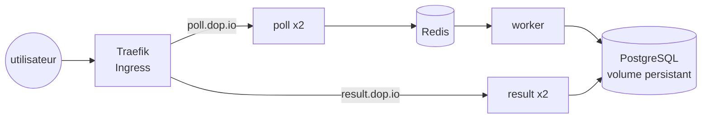

<div align="center">

# Bernstein

**Déployer une application de vote en microservices sur Kubernetes.**

     

<sub>Projet à 2 · 2024</sub>

</div>

## En deux mots

Une application de vote découpée en cinq briques (vote, résultats, worker, Redis, PostgreSQL) qu'il faut faire tourner proprement sur un cluster Kubernetes, avec un reverse proxy, du stockage persistant et du monitoring.

## Ce que ça fait

- Deployments, Services et ConfigMaps pour chaque brique
- **Ingress Traefik** avec RBAC dédié : `poll.dop.io` et `result.dop.io`
- **Volume persistant** pour PostgreSQL, secrets pour les identifiants
- Réplicas et limites de ressources CPU / mémoire
- **cAdvisor** en DaemonSet pour surveiller les conteneurs
- CI qui valide chaque manifeste

## Sous le capot

Les votes arrivent sur `poll`, passent par une file Redis, sont dépilés par le `worker` et enregistrés dans PostgreSQL, puis `result` les affiche. Traefik expose `poll` et `result` sur deux noms d'hôte. Les 19 ressources passent la validation `kubeconform`.



## Lancer le projet

```bash
cp postgres.secret.example.yaml postgres.secret.yaml   # mettre ses identifiants en base64
kubectl apply -f postgres.secret.yaml
kubectl apply -f .
```

## L'équipe

<a href="https://github.com/Wilson-Epitech/bernstein/graphs/contributors"></a>

Wilson Bordichon, Keliane Katary

**Ma part :** J'ai écrit tout le déploiement **PostgreSQL** (deployment, service, ConfigMap, volume), celui de **Redis**, et les **pipelines GitHub Actions** de validation.
